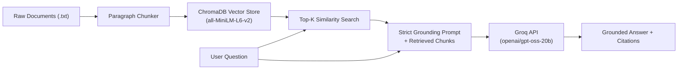

# 🏢 Internal Company Documents — Naive RAG System
> **NovaTech Solutions Policy & Knowledge Retrieval Assistant**  
> Powered by **ChromaDB**, **Groq Inference** (`openai/gpt-oss-20b`), and **Streamlit**

---

## 📖 Overview

This repository implements a **Naive Retrieval-Augmented Generation (RAG)** pipeline designed to provide employees with verified, accurate answers to questions about internal company policies, engineering standards, onboarding procedures, product capabilities, and security rules.

The system indexes 5 official corporate policy documents in `company Info/`:
1. `company_hr_policy.txt`: Leave policy, work from home rules, expense reimbursements, probation, performance management.
2. `engineering_standards.txt`: Git flow, branch naming, PR reviews, coding conventions, API design, database guidelines.
3. `onboarding_guide.txt`: Day 1 setup, IT provisioning, buddy system, 30-60-90 day roadmap.
4. `product_knowledge_base.txt`: CloudDesk Pro features, subscription management, billing, cancellations, refund policy.
5. `security_policy.txt`: Password rules, multi-factor authentication, remote work hygiene, device security.

---

## 🚀 Key Features

- **Semantic Vector Search**: Chunks documents into 120 paragraphs, embedded with `all-MiniLM-L6-v2` and stored in ChromaDB.
- **Strict Grounding Guardrails**: The LLM answers strictly from retrieved internal context. When information is absent, it responds with:
  > *"I don't have enough context or information to answer this question."*
  (Strictly avoiding hallucinations).
- **Multiple User Interfaces**:
  1. **Streamlit Web UI** (`app.py`): Interactive chat interface with sample question chips, configurable Top-K slider, and expandable retrieved source chunk viewer.
  2. **Interactive CLI** (`main.py --interactive`): Fast terminal Q&A loop.
  3. **Single CLI Queries** (`python main.py --query "What is the probation period?"`).
  4. **Jupyter Notebook** (`Naive RAG.ipynb`): Step-by-step educational notebook that works seamlessly both **locally** and in **Google Colab**.

---

## 🛠️ Project Structure

```text
Naive RAG/
├── company Info/                  # Internal company policy documents (.txt)
│   ├── company_hr_policy.txt
│   ├── engineering_standards.txt
│   ├── onboarding_guide.txt
│   ├── product_knowledge_base.txt
│   └── security_policy.txt
├── src/                           # Modular core RAG package
│   ├── __init__.py
│   ├── config.py                  # Environment settings, prompt templates, models
│   ├── loader.py                  # Dynamic text file loader & metadata parser
│   ├── chunker.py                 # Paragraph-based chunker
│   ├── vectorstore.py             # ChromaDB vector store wrapper
│   ├── generator.py               # Groq generation via OpenAI client
│   └── pipeline.py                # End-to-end NaiveRAGPipeline orchestrator
├── tests/
│   └── test_rag.py                # Automated unit and integration test suite
├── app.py                         # Streamlit web application
├── main.py                        # Command-line interface runner
├── Naive RAG.ipynb                # Dual-compatible Jupyter Notebook (Local + Colab)
├── requirements.txt               # Python package dependencies
├── .env.example                   # Environment variable template
└── README.md                      # Project documentation
```

---

## ⚙️ Installation & Setup

### 1. Install Dependencies
```bash
pip install -r requirements.txt
```

### 2. Configure Your Groq API Key
Copy the `.env.example` file to `.env`:
```bash
cp .env.example .env
```
Open `.env` and add your Groq API key:
```env
GROQ_API_KEY=gsk_your_actual_key_here
GROQ_MODEL=openai/gpt-oss-20b
DOCS_DIR=company Info
CHROMA_PERSIST_DIR=./chroma_db
```
*(You can obtain a free Groq API key at [console.groq.com/keys](https://console.groq.com/keys)).*

---

## 💻 How to Run

### 🌐 1. Launch the Streamlit Web App
```bash
streamlit run app.py
```
- Open your browser to the URL displayed (usually `http://localhost:8501`).
- Enter your Groq API key in the sidebar (if not already set in `.env`).
- Click any sample question chip or type your own question.
- View the grounded response and expand the **"Retrieved Context & Sources"** panel to inspect matched chunks and sources.

### ⌨️ 2. Terminal Interactive Mode
```bash
python main.py --interactive
```
Launches an interactive prompt where you can chat with the internal documents in real time.

### 🔍 3. Single Query CLI
```bash
python main.py --query "How many days of annual leave do employees get?"
```

### 📓 4. Jupyter Notebook
Launch Jupyter Notebook or open in VS Code / Cursor:
```bash
jupyter notebook "Naive RAG.ipynb"
```
Or upload `Naive RAG.ipynb` directly into **Google Colab**. The notebook automatically detects its environment and loads the API key from Colab secrets if `.env` is absent.

### 🐳 5. Run with Docker (Containerized)

#### Using Docker Compose (Recommended)
```bash
docker compose up --build
```

#### Using Docker CLI
```bash
# 1. Build the container image
docker build -t novatech-naive-rag .

# 2. Run container passing .env file
docker run -p 8501:8501 --env-file .env novatech-naive-rag
```
Visit **http://localhost:8501** in your browser.

---

## 🧪 Verification & Automated Testing

Run the test suite:
```bash
python -m unittest tests/test_rag.py
```
This tests:
- Document discovery and word counts across all 5 company files.
- Accurate chunk generation (120 chunks matching the baseline).
- Vector store indexing and top-$k$ semantic retrieval.
- Strict prompt formatting and negative refusal guardrails.

---

## 🧩 Architectural Walkthrough



1. **Ingestion**: Documents are loaded from `company Info/`, stripped of banner delimiters (`==`), and partitioned into paragraphs.
2. **Embedding**: ChromaDB creates 384-dimensional dense vectors using `all-MiniLM-L6-v2`.
3. **Retrieval**: At query time, the user question is projected into the same embedding space to identify the top 3 nearest text chunks.
4. **Generation**: The retrieved excerpts are assembled into a structured context window along with the question. The Groq model is strictly constrained to only state facts present in the text, preventing hallucination.

